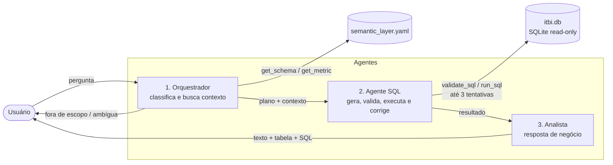
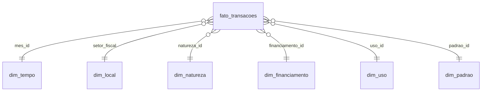

# Analista Virtual — Mercado Imobiliário de São Paulo

Sistema multiagente que responde, em linguagem natural, perguntas de negócio sobre as
**transações imobiliárias da cidade de São Paulo com ITBI pago (jan/2024 a dez/2025)**.
Ele traduz a pergunta para SQL, valida, executa e devolve uma resposta de negócio com
texto, tabela e o SQL usado.

> Projeto Final — "Do BI ao Analista Virtual" — Disciplina de Inteligência Artificial

---

## 1. Como rodar

**No Google Colab (mais fácil):** abra `Analista_Virtual_Colab.ipynb` no Colab e siga as células em ordem.

**Localmente:**

```bash
# 1) ambiente
python -m venv .venv
source .venv/bin/activate            # Windows: .venv\Scripts\activate
pip install -r requirements.txt

# 2) chave do modelo (NUNCA comitar o .env)
cp .env.example .env                 # e preencha LLM_API_KEY

# 3) carga dos dados + testes de qualidade  (~30 s)
python src/load_data.py

# 4) interface
streamlit run src/app.py              # ou: python src/app_gradio.py

# Extras
python src/orchestrator.py "Qual o preço médio do m² em Moema em 2025?"   # pelo terminal
pytest -q tests/                                                            # testes dos guardrails
python eval/run_eval.py --rodada antes                                      # avaliação com golden set
```

Os arquivos originais (`data/raw/*.xlsx`) vêm do site da Prefeitura de SP — veja `data/raw/README.md`.

---

## 2. Arquitetura



| # | Agente | Responsabilidade | Ferramentas |
|---|---|---|---|
| 1 | **Orquestrador** (`agents.Orquestrador`) | Classifica a pergunta em `dados`, `fora_escopo` ou `ambigua`; recusa com educação ou pede esclarecimento; busca na camada semântica tabelas, métricas, sinônimos e regras e monta um plano | `get_schema()`, `get_metric()` |
| 2 | **Agente SQL** (`agents.AgenteSQL`) | Escreve o SQL a partir do plano, valida antes de executar, executa e, se der erro, corrige — **no máximo 3 execuções** (limite imposto no código) | `validate_sql()`, `run_sql()` |
| 3 | **Analista** (`agents.Analista`) | Transforma o resultado em resposta de negócio: números, comparações, ressalvas e próxima pergunta sugerida | `make_chart()` (na interface) |

O fluxo entre eles está em `src/orchestrator.py`. Cada resposta registra tempo, tentativas de SQL,
validade na 1ª tentativa e tokens, o que alimenta a avaliação.

### Guardrails

| Guardrail | Onde |
|---|---|
| Somente leitura: bloqueia `INSERT`, `UPDATE`, `DELETE`, `DROP`, `ALTER`, `CREATE`, `PRAGMA`, `ATTACH`… e múltiplas instruções | `tools.validate_sql` (regex sem comentários/strings) **e** conexão SQLite `mode=ro` + `PRAGMA query_only` |
| `LIMIT` padrão (200) e máximo (1000) | `tools._garantir_limit` |
| Timeout de 10 s por consulta | `sqlite3.set_progress_handler` em `tools.run_sql` |
| Tabelas inexistentes e erros de sintaxe detectados antes de executar | `validate_sql` (+ `EXPLAIN`) |
| Avisos de regra de negócio (ex.: preço do m² sem `elegivel_m2 = 1`) | `validate_sql` |
| Perguntas fora de escopo recusadas com educação; ambíguas geram pergunta de esclarecimento | Orquestrador |
| SQL sempre visível para o usuário | `app.py` (expander "SQL usado") |
| Chave de API fora do repositório | `.env` (no `.gitignore`) + `.env.example` |

Os guardrails estão no **código**, não só no prompt — testados em `tests/test_guardrails.py`.

---

## 3. Dados e modelagem

**Fonte:** Prefeitura de São Paulo — Secretaria Municipal da Fazenda, *Dados das Transações
Imobiliárias com recolhimento de ITBI* (arquivos de 2024 e 2025). Cada linha é uma Declaração de
Transação Imobiliária (DTI) efetivamente paga. A base não contém nomes nem CPF de compradores/vendedores.

**Modelo estrela** (`data/processed/itbi.db`, gerado por `src/load_data.py`):



| Tabela | Linhas | Conteúdo |
|---|---:|---|
| `fato_transacoes` | 446.916 | valores, áreas, datas, flags de qualidade (`valor_valido`, `elegivel_m2`) e `preco_m2` |
| `dim_tempo` | 24 | mês de pagamento do ITBI (ano, mês, trimestre, semestre) |
| `dim_local` | 288 | setor fiscal do IPTU → bairro de referência e zona |
| `dim_natureza` | 34 | tipo de negócio (compra e venda, leilão, permuta…) e grupo |
| `dim_financiamento` | 5 | sem financiamento, SFH, MCMV, consórcio, SFI |
| `dim_uso` | 36 | uso do IPTU + categoria (apartamento, casa, terreno, garagem…) |
| `dim_padrao` | 32 | padrão construtivo do IPTU |

### Principais decisões de limpeza (detalhes em `data/processed/relatorio_qualidade.txt`)

- **Leitura posicional das abas:** JAN-2024 e OUT-2024 vêm sem cabeçalho e outras abas trazem cabeçalhos
  trocados (“ACC (IPTU)” repetido). Todas têm as mesmas 28 colunas na mesma ordem.
- **10 linhas desalinhadas/cabeçalhos repetidos** removidas; **1.345 duplicatas exatas** removidas.
- **Bairro:** o campo original é ~40% nulo e traz lixo (“TORRE 1”, “BL A”). A localização passou a ser o
  **setor fiscal** (3 primeiros dígitos do cadastro SQL), com o bairro mais frequente (normalizado) como
  nome de referência. A **zona** é aproximada pelas faixas de CEP.
- **Preço do m²:** em empreendimentos novos a área construída é a do prédio inteiro. Por isso o preço do m²
  só é calculado para `elegivel_m2 = 1`: compra e venda, imóvel 100% transmitido, uso residencial, área de 15 a
  2.000 m² e preço entre R$ 500 e R$ 50 mil/m².
- **Valores < R$ 10 mil** marcados com `valor_valido = 0` e excluídos das métricas de valor.

### Testes de qualidade (rodam a cada carga)

Nulos em chaves, unicidade das PKs, **chaves órfãs** entre fato e cada dimensão, domínio de valores,
regra do ITBI (base de cálculo ≥ valor declarado), volume mínimo (≥ 5.000 linhas, ≥ 8 colunas) e cobertura dos 24 meses.

---

## 4. Camada semântica

`src/semantic_layer.yaml` é o centro do projeto. Contém:

- descrição de cada tabela e coluna, com unidades e armadilhas (ex.: `bairro_informado` não deve ser usado);
- relacionamentos (joins);
- **11 métricas** com SQL e filtro oficiais (`qtd_transacoes`, `volume_financeiro`, `valor_medio`, `preco_medio_m2`, `pct_financiadas`…);
- sinônimos em português (“ticket médio”, “VGV”, “apto”, “MCMV”, “leilão”);
- **regras de negócio** (tempo padrão = mês de pagamento; “vendas” = compra e venda; “último trimestre” = 4T/2025…);
- 3 exemplos de consulta (diferentes das perguntas do golden set).

---

## 5. Avaliação

- `eval/golden_set.csv`: 20 perguntas (7 fáceis, 7 médias, 4 difíceis, 2 armadilhas), com SQL de referência escrito
  à mão e resposta esperada (gerado por `eval/build_golden_set.py`). As perguntas foram escritas **antes** do ajuste dos prompts.
- `eval/run_eval.py`: roda o sistema em cada pergunta e compara o resultado com o da referência,
  independentemente do nome/ordem das colunas (tolerância de 1%). Nas armadilhas, acerta se recusar ou pedir esclarecimento.
- Métricas: acurácia, % de SQL válido na 1ª tentativa, média de tentativas de correção, tempo médio e tokens.
- `eval/resultados.csv` + `eval/resumo_metricas.md`: resultados **antes** e **depois** das correções.
- `eval/analise_erros.md`: cada falha, a causa e a correção.

---

## 6. Stack e justificativas

| Escolha | Por quê |
|---|---|
| **Python** | Padrão para dados e LLM; todo o grupo conhece |
| **SQLite** | Vem com o Python (zero instalação), arquivo único, suporta modo somente leitura e interrupção por timeout. 450 mil linhas rodam em milissegundos |
| **pandas + python-calamine** | Leitura rápida dos `.xlsx` grandes (~80 MB) com abas mensais |
| **API OpenAI-compatível (`openai` SDK)** | Mesmo código funciona com Groq, Gemini, OpenAI ou Ollama só trocando `LLM_BASE_URL`/`LLM_MODEL` no `.env` |
| **Groq + `openai/gpt-oss-120b`** | Plano grátis sem cartão. Testamos antes o Gemini: o free tier limita a 20 requisições/dia por modelo (≈4 perguntas), o `gemini-4-hydrogen` deu erro 503 por alta demanda e o `gemini-3.5-flash-lite` não chamava as ferramentas |
| **Agentes implementados “à mão”** (sem LangChain/CrewAI) | O loop de tool calling tem ~40 linhas e fica fácil de explicar; controlamos o limite de 3 tentativas e coletamos métricas por agente |
| **Streamlit / Gradio** | Interface de chat com tabela, gráfico e SQL. Gradio roda dentro do Google Colab com link público |
| **YAML** para a camada semântica | Legível por pessoas e pela LLM; versionável no Git |

---

## 7. Limitações conhecidas

- Bairro de referência e zona são **aproximações** (setor fiscal e CEP), não a divisão oficial de distritos.
- Preço do m² usa a área construída do IPTU, que inclui áreas comuns — tende a ficar abaixo do preço “de anúncio”.
- Valores nominais (sem correção pela inflação). Datas pelo mês de pagamento do ITBI.
- A base não tem aluguel nem dados de pessoas.

## 8. Estrutura

```
projeto/
├── README.md  USO_DE_IA.md  requirements.txt  .env.example
├── data/raw/            # planilhas originais da Prefeitura
├── data/processed/      # itbi.db + relatorio_qualidade.txt (gerados)
├── Analista_Virtual_Colab.ipynb   # roteiro para rodar tudo no Google Colab
├── src/  load_data.py  semantic_layer.yaml  tools.py  agents.py  orchestrator.py  app.py  app_gradio.py
├── eval/ golden_set.csv  build_golden_set.py  run_eval.py  resultados.csv  analise_erros.md
└── tests/test_guardrails.py
```
